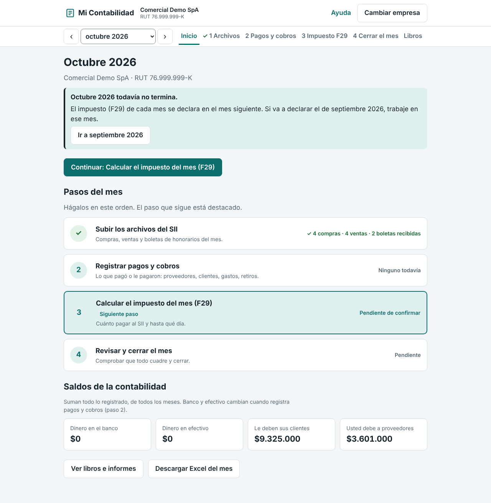
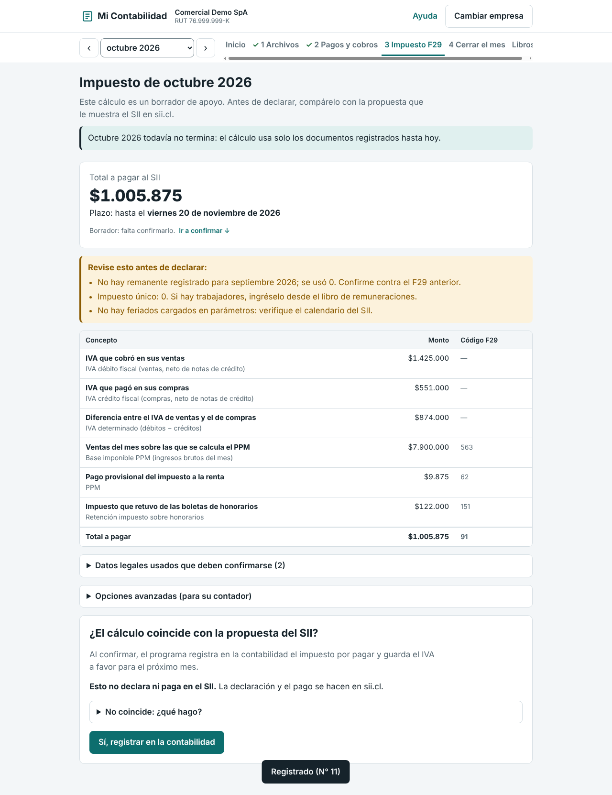
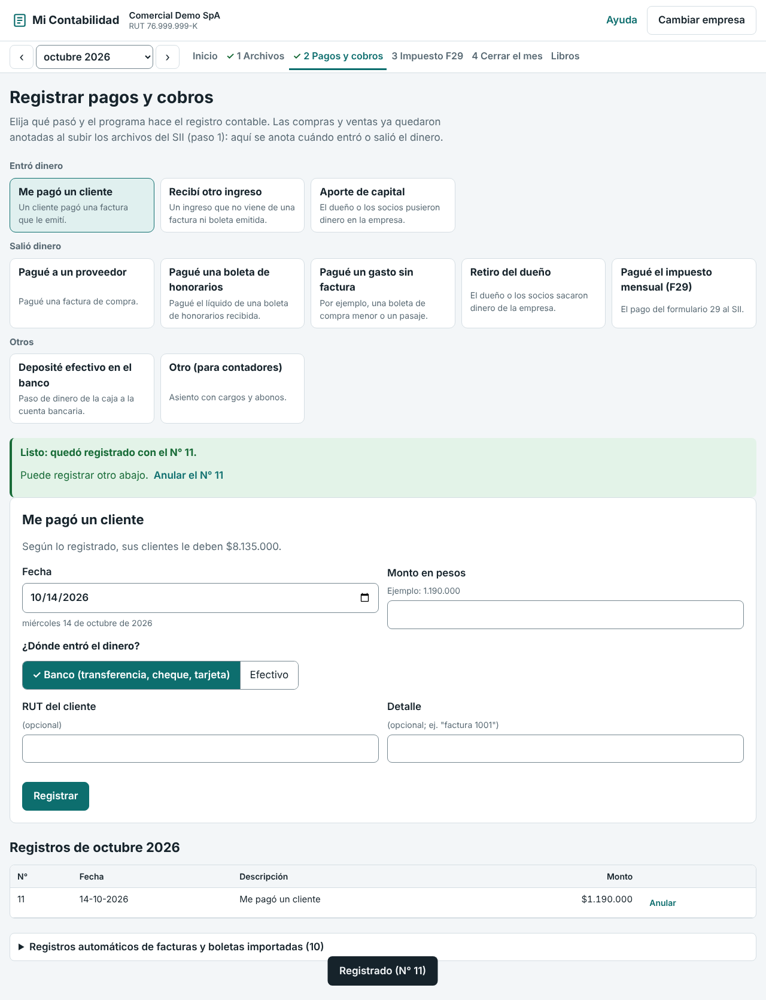

# contasii — contabilidad automatizada para contribuyentes chilenos

Programa para llevar la contabilidad de **una empresa o una persona natural** a partir de
los archivos que entrega el SII:

- detalle del **Registro de Compras y Ventas (RCV)**,
- boletas de honorarios electrónicas, recibidas y emitidas.

Con eso genera los asientos, los libros y un borrador del F29. Se usa con **ventanas y
botones en el navegador**, sin escribir comandos. También tiene una versión de línea de
comandos para contadores.

> **Alcance.** Es una herramienta de apoyo. El cálculo del F29 es un borrador para
> cotejar con la propuesta del SII en sii.cl. No reemplaza la declaración ni la revisión
> profesional. Antes de presentar cualquier cifra ante el SII o un cliente, haga la
> verificación documental.

## Cómo empezar (para cualquier persona)

### Windows: instalador, sin Python

1. Descargue **`Instalar-MiContabilidad.exe`** desde la sección **Releases** del
   repositorio, versión «Mi Contabilidad 0.5.0 (preliminar)».
2. Haga doble clic en el archivo. El programa no está firmado digitalmente, así que
   Windows puede mostrar **«Windows protegió su PC»**: presione **«Más información»** y
   luego **«Ejecutar de todos modos»**.
3. Siga el asistente. No pide permisos de administrador y crea el acceso directo
   **«Mi Contabilidad»** en el Escritorio y en el menú Inicio.
4. Abra **Mi Contabilidad**. El programa se abre en su propia ventana de **Google Chrome**,
   sin pestañas ni barra de direcciones. Para salir, cierre esa ventana. Si hace doble
   clic de nuevo con el programa abierto, se muestra la misma ventana.

**Requiere Google Chrome.** El programa usa solo Chrome, aunque su navegador habitual sea
otro. Si no lo encuentra, lo avisa con el enlace de descarga
(<https://www.google.com/chrome/>). La ventana del programa usa un perfil de Chrome propio,
separado del suyo: no ve sus marcadores, contraseñas ni pestañas.

Los datos se guardan en **Documentos\Mi Contabilidad**. Por eso desinstalar o instalar
una versión nueva no borra la contabilidad.

En la misma página de descarga hay una versión sin instalar,
`MiContabilidad-portable.zip`: se descomprime y se abre `MiContabilidad.exe`.

El instalador lo construye automáticamente GitHub Actions
(`.github/workflows/instalador-windows.yml`) en un Windows real. Antes de publicarlo,
el proceso ejecuta las pruebas, instala el programa y recorre el flujo del mes con
los datos de ejemplo.

### Mac, Linux o Windows con Python

1. **Instale Python** (una sola vez) desde <https://www.python.org/downloads/>.
   En Windows, al instalar, marque la casilla **"Add Python to PATH"**.
2. **Copie la carpeta `contabilidad-sii`** a su computador, por ejemplo al Escritorio.
3. **Haga doble clic en el archivo de inicio:**
   - Windows: `ABRIR CONTABILIDAD (Windows).bat`
   - Mac: `Abrir contabilidad (Mac).command`. La primera vez puede pedir permiso: clic
     derecho → Abrir.

Si falta Python, el archivo de inicio lo avisa y abre la página de descarga. La primera
vez también instala solo el complemento para Excel, lo que requiere internet. Con esta
forma de uso, los datos quedan en la carpeta `mis_empresas/`, junto al programa. También
se necesita Google Chrome; el programa se cierra al cerrar su ventana.

Algunos Python no permiten instalar complementos: el del sistema en Ubuntu 24.04 (comprobado) y,
probablemente, el de Homebrew en Mac. Con ellos el programa abre igual, pero no puede
descargar el Excel. Instale Python desde python.org, como indica el paso 1.

### Qué verá

Cada mes se trabaja en **4 pasos**, en lenguaje simple:

| Paso | Qué hace la persona |
|---|---|
| 1. Subir los archivos del SII | Trae las compras y ventas del mes desde el SII, ingresando con su clave tributaria o Clave Única (ver más abajo). También acepta archivos: CSV, Excel (.xlsx), la planilla de boletas que descarga el SII (.xls) o una tabla copiada desde la página del SII. Las boletas de honorarios se pueden agregar a mano. El programa reconoce cuál es cuál, muestra cuántos documentos y qué total trae cada uno, y pide confirmar antes de registrarlos. |
| 2. Registrar pagos y cobros | Elige lo que pasó ("Me pagó un cliente", "Pagué a un proveedor", "Pagué el impuesto mensual"…), escribe monto y fecha, e indica banco o efectivo. El programa arma el asiento contable. |
| 3. Calcular el impuesto (F29) | Ve el total a pagar, la fecha límite y el detalle explicado en palabras simples, y confirma para registrarlo. |
| 4. Revisar y cerrar el mes | Ve las comprobaciones de cuadratura en verde o rojo y cierra el mes. |

**Barra superior.** Siempre a la vista, con:

- la empresa abierta (nombre y RUT);
- el mes de trabajo, con flechas para pasar al mes anterior o al siguiente;
- los pasos del mes, con ✓ en los que están hechos.

Desde ahí se va a cualquier paso sin volver al inicio. La ventana recuerda dónde estaba:
al recargarla (F5) vuelve a la misma pantalla, y Alt+← vuelve a la anterior.

**Inicio del mes:**

- destaca el paso que sigue y ofrece «Continuar» hacia él;
- muestra los saldos de la contabilidad: banco, efectivo, lo que le deben los clientes y lo
  que debe a proveedores;
- si el mes todavía no termina, lo dice y ofrece ir al mes anterior, que es el que se
  declara.

**Montos.** Se escriben como se acostumbra en Chile: `1.190.000`, `1190000` o
`$ 1.190.000`. Bajo el campo se ve cómo se entendió («= $1.190.000»). Un monto con
decimales no se envía.

**Datos sin registrar.** Si deja un formulario a medio llenar o un archivo revisado sin
importar, el programa pregunta antes de cambiar de pantalla o de mes.

**Pagos y cobros:**

- las operaciones están agrupadas en «Entró dinero», «Salió dinero» y «Otros»;
- después de registrar, el formulario queda abierto para anotar otro, con el número del
  registro y la opción de anularlo;
- la lista separa lo que registró la persona de los registros automáticos de las facturas
  y boletas importadas.

**Impuesto (F29):**

- dice que confirmar no declara ni paga en el SII;
- explica qué hacer si el cálculo no coincide con la propuesta del SII;
- recuerda, por empresa y mes, las opciones avanzadas (tasa de PPM, impuesto único…) y las
  muestra sobre el total;
- después de confirmar, ofrece registrar el pago.

**Cierre del mes:**

- avisa si falta registrar el impuesto;
- no permite cerrar un mes que no ha terminado;
- pide marcar una casilla antes de cerrar;
- al terminar, ofrece pasar al mes siguiente.

**Libros e informes:**

- Diario, Mayor, Balance de 8 columnas, Ganancias y pérdidas y descarga a Excel;
- en «Documentos», búsqueda por RUT, nombre o número;
- las tablas largas mantienen el encabezado a la vista.

**Accesibilidad.** Todo se puede usar con el teclado, incluida la elección de archivos y
las pestañas con flechas. Al cambiar de pantalla, el foco va al título. Los avisos se
anuncian al lector de pantalla y los campos tienen bordes con contraste suficiente.

Las acciones que no se pueden deshacer piden confirmación en pantalla.





### Dónde quedan los datos

Todo se guarda en **Documentos\Mi Contabilidad** si usa el instalador, o en la carpeta
**`mis_empresas/`**, junto al programa, si lo usa con Python. Hay un archivo por RUT. La
pantalla de Ayuda muestra la ubicación exacta. El programa solo acepta conexiones desde el
mismo computador y solo se conecta al SII cuando usted lo pide. **Respalde esa carpeta** con regularidad, por ejemplo en OneDrive o en un
pendrive.

### Eliminar una empresa o cliente

En la pantalla «¿De quién es la contabilidad?», cada empresa tiene **«Enviar a la papelera»**.
Pide confirmación y mueve la contabilidad a la **Papelera** (la subcarpeta `Papelera` de la
carpeta de datos), con la fecha y hora en que se eliminó. Justo después aparece
**«Deshacer»**. La misma pantalla ofrece **«Continuar con»** la última empresa abierta y,
con dos o más, un buscador por nombre o RUT. Desde la Papelera, al pie de esa
misma pantalla, puede **«Restaurar»** la contabilidad o **«Borrar para siempre»**; para borrar
hay que escribir el RUT y no se puede deshacer. No se puede restaurar encima de una
contabilidad activa con el mismo RUT.

### Borrar documentos o boletas importados

Para quitar facturas, notas o boletas de honorarios que se importaron por error (por ejemplo,
en la empresa equivocada o en el mes equivocado):

- **Al importar:** la tarjeta del archivo ofrece **«Deshacer esta importación»**, que borra
  los documentos que ese archivo registró. Una boleta agregada a mano ofrece **«Borrar esta
  boleta»**.
- **Después:** en **«Libros» → «Documentos»** del mes, presione **«Corregir: borrar
  documentos importados por error»**. Marque los documentos y presione **«Borrar los
  elegidos»**. Se pide un motivo. Si usa la búsqueda, solo se borran los documentos que
  están a la vista.

Qué hace el programa al borrar:

1. **Anula el registro contable** de cada documento con un registro contrario fechado igual
   que el original. Los dos quedan en el Libro Diario: la contabilidad no borra asientos, los
   anula.
2. **Marca el documento como borrado**, con la fecha, el motivo y el número del registro que
   lo anuló. Deja de contar en el F29, en los libros, en el Excel, en los controles de
   «Revisar y cerrar» y en la consulta de estado al SII. Los borrados se ven al pie de
   «Documentos», en «Documentos borrados de este mes».
3. **Lo anota en la bitácora** de la base.

Si después vuelve a importar el mismo archivo, los documentos borrados se registran de nuevo,
con un aviso por cada uno (los que no se borraron se omiten como repetidos). Las consultas de
estado al SII que se hicieron antes del borrado se descartan, porque eran de los datos
anteriores.

No se puede borrar:

- en un **mes cerrado**;
- un documento que **entró en el F29 registrado** del mes. Para corregirlo, primero anule ese
  registro en «Pagos y cobros» (la anulación queda en el mismo mes del F29), borre los
  documentos y vuelva a confirmar el F29. Un documento importado **después** de registrar el
  F29 sí se puede borrar, porque no está en él: al importarlo, el programa avisa que el F29 ya
  estaba registrado.

Los documentos importados con la opción de **centralización mensual** (solo por la línea de
comandos) comparten un solo registro contable: se borran **todos juntos** (los que entraron en
esa centralización), y el programa la anula. Un documento borrado no se puede volver a
importar en modo centralizado: se importa por documento. Si los documentos nuevos de un archivo
se compensan entre sí (por ejemplo, una factura y su nota de crédito por el total), la
centralización no los registra: el programa pide importarlos por documento.

Un documento con todos sus montos en cero (por ejemplo, una nota que solo corrige texto) no se
registra, porque no afecta la contabilidad ni el F29: la importación lo informa. Uno que trae
«Monto Total» pero cuyos componentes (exento, neto, IVA, otros impuestos) suman cero detiene la
importación para revisar el archivo.

El programa avisa, sin impedir el borrado, cuando:

- el F29 del mes ya se había confirmado sin registro contable (por ejemplo, un mes que solo
  tiene boletas) o ya se pagó: hay que volver a confirmarlo y, si ya se declaró, rectificarlo;
- un F29 de un mes siguiente ya se confirmó con el remanente de IVA, que cambia con el borrado;
- el registro del documento se había anulado a mano en otro mes (posible en versiones
  anteriores): los controles de esos dos meses pueden quedar descuadrados.

Si hay pagos o cobros registrados con el RUT de un documento borrado, el programa avisa: esos
movimientos no se anulan solos. En «Pagos y cobros» (y con el comando `anular`) no se anulan
sueltos los registros que vienen de una factura o boleta, las centralizaciones de documentos
ni las anulaciones: el documento seguiría contando en el F29 o volvería a la contabilidad sin
volver al F29. Para los documentos, el programa indica borrarlos en «Documentos». Las demás
anulaciones de «Pagos y cobros» se fechan igual que el registro anulado mientras su mes siga
abierto, para que ese mes quede corregido; si ya está cerrado, van con la fecha de hoy.
«Revisar y cerrar» comprueba además que el F29 del mes esté registrado una sola vez.

## Traer compras y ventas desde el SII (clave tributaria o Clave Única)

En el paso 1 del mes, el botón **«Ingresar al SII»** hace lo siguiente:

1. Abre una ventana de Google Chrome en la **página oficial de ingreso
   del SII** (`zeusr.sii.cl`). Usted ingresa ahí con su RUT y clave tributaria, o con el
   botón de Clave Única. La dirección se ve en la barra del navegador.
2. Al ingresar, la ventana pasa al Registro de Compras y Ventas y el programa muestra
   «Conectado al SII con el RUT …».
3. **«Traer compras y ventas de [mes]»** pide al SII el detalle del mes de la empresa
   abierta. Lo muestra en la lista con el número de documentos y el total, y usted
   confirma con «Importar». Nada se registra sin su confirmación.
   Con la casilla **«Traer compras y ventas apenas me conecte»** (marcada al instalar), lo
   hace solo al detectar el ingreso, sin otro clic. Lo traído queda amarrado a la empresa y
   al mes desde donde se pidió: si usted se cambia de empresa mientras el SII responde, el
   archivo no aparece en la otra; lo verá al volver a «Subir los archivos» de la empresa
   original.
4. Si la descarga automática falla, el programa lo dice. En la ventana del SII, elija el
   mes, abra Compras o Ventas y presione «Descargar Detalles». El programa recibe el
   archivo solo y lo muestra en la lista. Lo mismo vale para el informe de boletas de
   honorarios descargado en esa ventana. Si el archivo se descargó con la sesión de un RUT
   distinto del de la empresa abierta, el programa lo advierte: un informe de boletas no se
   puede importar ahí (se ofrece dejarlo en la contabilidad de ese RUT, si existe) y un
   detalle de compras o ventas pide confirmar que es de esa empresa.
5. «Desconectar» **cierra la sesión en el SII** (el mismo «Cerrar Sesión» de su sitio) y
   luego la ventana. Si el SII no responde en 6 segundos, cierra la ventana igual (la
   sesión del SII expira sola). Lo que alcanzó a descargar en la ventana se entrega antes de
   cerrarla. Conviene usarlo en vez de cerrar la ventana: el SII limita las sesiones
   abiertas al mismo tiempo por RUT.

**Su clave.** El programa no pide, no ve y no guarda la clave tributaria ni la Clave
Única: se escriben en la página del SII. La ventana usa un perfil temporal, separado de
su navegador habitual. Ese perfil se borra al cerrarla, junto con la sesión del SII.
Mientras está abierta, el programa la controla por un puerto local (solo `127.0.0.1`).

**Contador con varias empresas.** El programa pide el detalle del RUT de la empresa
abierta. Si quien ingresó no tiene acceso a esa empresa en el SII, el programa muestra
el error que entrega el SII. La conexión sirve para todas las empresas del programa:
cambie de empresa y presione «Traer» sin volver a ingresar. Según guías del SII leídas en
fragmentos de búsqueda (fuente secundaria; [VERIFICAR] en
[sii.cl, guía de modificación del tipo de compra en el RCV](https://www.sii.cl/servicios_online/guia_modificacion_tipo_compra_en_rcv.pdf)),
quien es **usuario autorizado** de una empresa entra al RCV con su propia clave y el campo
RUT le lista todas las empresas en que lo es. Cada empresa lo agrega en «Mantención de
usuarios autorizados». Las boletas de honorarios, en cambio, se consultan con la sesión del
propio contribuyente (fuentes de terceros, sin confirmación oficial vigente).

### Por qué no es inmediato

- **El ingreso lo hace una persona.** El SII no publica un servicio web que entregue el
  detalle del RCV ni de las boletas (no se encontró ninguno; los servicios con certificado
  que sí existen, como el de aceptación y reclamo de DTE, trabajan documento por documento).
- **El SII protege el detalle.** Según la biblioteca
  [devlas-cl/dte-sii](https://github.com/devlas-cl/dte-sii) (`SiiPortalAuth.js`, octubre de
  2026; fuente secundaria), el detalle del RCV exige reCAPTCHA v3. Por eso la solicitud se
  hace dentro de la página real del RCV y, si esa página tiene reCAPTCHA cargado, el
  programa pide ahí el código, como lo haría la propia página.
- **La aplicación del RCV tarda en iniciar.** El programa espera a que la página del RCV
  termine de cargar (hasta 40 s) y 3 s más para que inicie su sesión. Si la página tiene
  reCAPTCHA, espera hasta 15 s a que termine de cargar y hasta 20 s por el código.
- **Las compras recientes pueden estar en «Pendientes».** Según preguntas frecuentes del
  SII (leídas en fragmentos de búsqueda, [VERIFICAR] en
  [sii.cl](https://www.sii.cl/preguntas_frecuentes/factura_electronica/001_003_6976.htm)),
  una factura recibida sin acuse ni reclamo pasa al Registro a los 8 días corridos. El
  programa trae solo el Registro, que es lo que cuenta para el F29.

### Qué está verificado y qué falta

Verificado contra el SII real el 13-10-2026 con Edge, y de nuevo el 14-10-2026 con
Google Chrome (el navegador que usa el programa desde la versión 0.5.0). Ambas pruebas se
hicieron sin credenciales, desde GitHub Actions en Windows:

- La página de ingreso recibe después de «?» la dirección a la que vuelve. Tiene el
  formulario de RUT y clave y el botón de Clave Única
  (`/cgi_AUT2000/InitClaveUnicaP.cgi`), que lleva a `accounts.claveunica.gob.cl`.
- El código de esa página (`AutAll.js`, función `autenticado`) considera ingresada a la
  persona cuando existe la cookie `RUT_NS`, y `DV_NS` guarda el dígito verificador. El
  programa usa esas cookies para detectar el ingreso y mostrar el RUT.
- Sin sesión, la dirección del Registro de Compras y Ventas
  (`www4.sii.cl/consdcvinternetui/`) redirige a la página de ingreso.
- El programa abre el navegador, lo controla, recibe descargas y lo cierra borrando el
  perfil.

**[VERIFICAR] con una sesión real:**

- El servicio que pide el detalle (`getDetalleCompraExport` / `getDetalleVentaExport`),
  el formato de la solicitud y el uso de la cookie `TOKEN` provienen de fuentes
  secundarias. El SII no publica documentación de ese servicio. Las fuentes son el SDK de
  código abierto [emisso-ai/emisso-sii](https://github.com/emisso-ai/emisso-sii)
  (`packages/engine/src/rcv/index.ts`, versión de mayo de 2026) y publicaciones de
  desarrolladores de 2017 a 2024. Si no funciona, queda la descarga desde la ventana
  (punto 4).
- El ingreso con Clave Única no se pudo probar: desde los servidores de GitHub,
  `accounts.claveunica.gob.cl` respondió «403 Forbidden».
- Si el detalle exige reCAPTCHA v3 y si la página del RCV lo tiene cargado al momento de
  pedirlo. Las fuentes secundarias se contradicen: emisso-sii envía un valor fijo y
  devlas-cl/dte-sii dice que hace falta reCAPTCHA v3.

También verificado (13-10-2026, código público del SII en
`zeusr.sii.cl/admin/responsive_barranav.js`): el enlace «Cerrar Sesión» del SII apunta a
`https://zeusr.sii.cl/cgi_AUT2000/autTermino.cgi`, que es la dirección que usa
«Desconectar».

## Boletas de honorarios

Se pueden registrar de tres maneras, en el paso 1 del mes:

1. **Subir el informe del SII.** En sii.cl: Servicios online → Boletas de honorarios
   electrónicas → Consultas sobre boletas de honorarios electrónicas → «Consultar boletas
   recibidas» (o «emitidas») → informe mensual → **«Ver informe como planilla
   electrónica»**. Se sube ese archivo tal cual, aunque termine en `.xls`.
2. **Pegar la tabla** copiada desde esa página, con los títulos de las columnas.
3. **Agregar una boleta a mano**: recibida o emitida, número, fecha, RUT, nombre, monto
   bruto y retención. Los montos van en pesos enteros («500000» o «500.000»); con decimales
   distintos de cero el formulario pide corregirlos. Si la fecha es de otro mes, pide
   presionar otra vez para confirmar. La retención se sugiere con la tasa del año de los parámetros
   (15,25 % en 2026, `retencion_honorarios` en `parametros/2026.json`) y se puede corregir.

Al importar un archivo de boletas se puede indicar si son **recibidas** (usted pagó) o
**emitidas** (usted cobró); el programa lo propone según las columnas. Se omiten las
anuladas, la fila de totales y las notas al pie. Si una fila trae un RUT o un monto pero su
número de boleta no se puede leer, se omite **con una alerta** para registrarla a mano. El
número se lee sin separadores de miles ni ceros a la izquierda («1.002» = 1002,
«0045» = 45), así la misma boleta no se registra dos veces si llega por dos vías. Si la
tabla trae «Folio» y «N°», se usa «Folio». Si una boleta ya registrada aparece después
como ANULADA, el programa no la quita sola: avisa que sigue contando en el F29 de ese mes y
que se puede borrar en «Libros» → «Documentos» (ver «Borrar documentos o boletas
importados»). Una boleta «vigente con solicitud de
anulación pendiente» se registra con una alerta. Una boleta emitida sin receptor se
registra sin cliente, con alerta. Si el informe de emitidas trae retención a cargo del
emisor («Ret. Emisor»), no se registra y queda como alerta para revisarla.

**Fuentes y lo que falta verificar.** La ruta del menú viene de preguntas frecuentes del
SII leídas en fragmentos de búsqueda. El formato del archivo viene de repositorios de
terceros: [Erin3012/icontador](https://github.com/Erin3012/icontador) (PR 15) indica que
el `informeMensualREC.xls` de recibidas es una tabla HTML en ISO-8859-1 con las columnas
N°, Fecha, Estado, Fecha Anulación, Rut, Nombre o Razón Social, Soc. Prof., Brutos,
Retenido y Pagado; [crilam/mcp-sii](https://github.com/crilam/mcp-sii) (`tests/fixtures`)
muestra el informe de emitidas en pantalla, con «Ret. Emisor», «Ret. Receptor» y
«Líquidos». **[VERIFICAR] con un archivo real del SII**: las columnas exactas de la
planilla de emitidas, cómo aparece el estado de una boleta con anulación pendiente y si la
planilla incluye todas las páginas cuando el mes tiene más de 100 boletas. El Excel antiguo
(`.xls` binario) no se puede leer: el programa pide guardarlo como `.xlsx` o `.csv`.

Las pruebas automáticas (`tests/test_sii_portal.py`) recorren todo el flujo con Google
Chrome real contra un SII simulado en el mismo computador.

## Probar la conexión con el SII y el certificado digital

En el programa, el botón **«Conexión SII»** de la barra superior abre una pantalla con
dos pruebas:

1. **Conexión.** No necesita certificado. Pide al SII una semilla, que es el primer paso
   de la «autenticación automática» descrita en el *Manual de Desarrollador
   Autenticación Automática* del SII.
2. **Certificado digital.**
   - Usted elige su archivo `.pfx` o `.p12` y escribe la clave.
   - El programa muestra a nombre de quién está el certificado y su vigencia.
   - Luego firma la semilla y pide un token al SII. Si el SII entrega el token, el
     certificado funciona con sus servicios web.

Por defecto se usa el **ambiente de pruebas del SII** (certificación, `maullin.sii.cl`).
También puede elegirse producción (`palena.sii.cl`). Ninguna de las dos pruebas envía ni
modifica declaraciones.

El archivo del certificado y su clave se usan **solo en memoria** y no se guardan.

La firma XML (`contasii/sii_ws.py`) tiene estas características:
- es envuelta, con C14N inclusiva, RSA-SHA1 y digest SHA1;
- su KeyInfo incluye KeyValue y X509Data;
- se verificó con libxmlsec1 en las pruebas automáticas.

### Resultado de la prueba contra el SII real

Se probó el 06-10-2026 en el ambiente de certificación, desde GitHub Actions:

- **Semilla:** el SII la entregó con estado `00`.
- **Formato:** la definición del servicio (WSDL) confirma la operación `getToken` con el
  parámetro `pszXml`.
- **Certificado autofirmado de prueba:** el SII respondió *«XML Inválido, elemento
  ‘Certificate’ no existe, función getCertificado»*.

Según el manual oficial, los errores de formato o de firma son los estados 01 a 05 y la
falta de semilla es el 06. Se infiere, sin confirmación expresa del SII, que la firma pasó
la validación y que se rechazó el certificado por no ser reconocido. El manual indica que
solo se permite autenticarse con un certificado digital válido.

**Falta la prueba con un certificado real.**

## Consultar el estado de las facturas en el SII

En **Libros e informes → Documentos**, el panel **«Consultar el estado de estas facturas en
el SII»** revisa cada factura o nota electrónica del mes, de compras y de ventas.
`contasii/sii_dte.py` consulta el servicio `QueryEstDte` (operación `getEstDte`) del SII
para cada documento:

1. Abre el certificado digital, en memoria.
2. Obtiene el token de autenticación automática.
3. Consulta cada documento con estos datos: RUT de quien consulta, RUT del emisor y del
   receptor, tipo, folio, fecha de emisión y monto total.

Cada documento queda marcado en la columna «Estado SII» según la tabla oficial del
manual *Consulta de Estado DTE*:

| Estado | Significado | Marca |
|---|---|---|
| DOK | Recibido por el SII; los datos coinciden | verde |
| DNK | Recibido, pero los datos NO coinciden con lo registrado | amarillo |
| TMD / TMC | Una nota de débito o de crédito modifica textos | amarillo |
| MMD / MMC | Una nota de débito o de crédito modifica montos | amarillo |
| FAU | No recibido por el SII | rojo |
| FNA | No autorizado | rojo |
| FAN | Anulado | rojo |
| EMP | Empresa no autorizada a emitir documentos electrónicos | rojo |
| AND / ANC | Una nota de débito o de crédito anula el documento | rojo |

Detalles de funcionamiento:
- Cada consulta se guarda con su fecha en la tabla `estado_sii`, como historial. **No
  modifica la contabilidad ni nada en el SII.**
- Solo se consultan los tipos 33, 34, 43, 46, 56, 61, 110, 111 y 112. Las boletas
  tienen servicios propios y no se incluyen.

Verificado en el ambiente de certificación real, el 12-10-2026:
- el WSDL tiene la operación `getEstDte` con los 11 parámetros del manual;
- con un token inválido, el SII responde con estado `001` «TOKEN NO EXISTE» (el manual
  menciona `002` y `003`);
- el «Manual de Desarrollador Externo Consulta de Estado DTE» (versión del 22/12/2010)
  indica para `FechaEmisionDte` el «formato DDMMAAAA», que es el que usa el programa.
  (La «Consulta Avanzada», `QueryEstDteAv`, usa otro formato, DD-MM-AAAA; el programa
  no usa ese servicio.)

**Pendiente:** probar con un certificado real y facturas reales.

## Qué automatiza

| Función | Detalle |
|---|---|
| Partida doble | Rechaza asientos descuadrados y líneas en cuentas no imputables o inexistentes. Numera en forma correlativa y sin saltos. |
| Inalterabilidad | Los asientos no se borran ni se editan. Se anulan con un contra-asiento. Cada asiento lleva un hash SHA-256 encadenado al anterior, y `verificar` detecta cualquier modificación directa de la base. |
| Cierre de períodos | Un período cerrado no admite asientos nuevos. |
| Importación del RCV | Lee compras y ventas, reconoce columnas por nombre y valida RUT (módulo 11). Omite duplicados (tipo + RUT + folio). Invierte los signos de las notas de crédito. Separa activo fijo, IVA no recuperable, IVA de uso común y otros impuestos. Trata aparte las facturas de compra (DTE 46). Contabiliza por documento o en una centralización mensual. |
| Honorarios | Recibidos: gasto, retención por pagar y líquido por pagar. Emitidos: ingreso y retención como pago provisional. Omite las boletas anuladas y compara la retención informada con la tasa del año. |
| Libros | Diario, Mayor con saldo acumulado, Balance tributario de 8 columnas con prueba de cuadratura y Estado de resultados. |
| F29 (borrador) | Débito, crédito, remanente anterior (reajustado por UTM si está cargada), remanente siguiente, base y monto del PPM según régimen, retención de honorarios, impuesto único y total. Puede generar el asiento de centralización de IVA/PPM. |
| Impuesto único 2ª cat. | Cálculo por tramos en UTM. |
| Plazos | Vencimiento del F29: día 12, o día 20 para quien declara por internet y emite documentos electrónicos. |
| Controles | Cuadra el IVA del auxiliar de documentos contra el Mayor, cuenta los documentos sin RUT válido y revisa la integridad. |
| Exportación | Excel con hojas Diario, Mayor, Balance, Compras, Ventas, Honorarios, F29 e Integridad, y CSV. |
| Obligaciones | Lista de libros y obligaciones según el régimen, con su norma y estado de verificación. |

Regímenes: `14A` (general), `14D3` (Pro Pyme general), `14D8` (Pro Pyme transparente)
y `PN_HONORARIOS` (persona natural con rentas del art. 42 N°2 LIR).

## Uso por línea de comandos (contadores)

```bash
cd contabilidad-sii
C="python3 -m contasii --db mi_empresa.db"     # una base por RUT

$C init --rut 76.111.111-6 --razon "MI EMPRESA SPA" --tipo empresa --regimen 14D3
$C importar-rcv RCV_COMPRA_202610.csv --libro compra --periodo 2026-10
$C importar-rcv RCV_VENTA_202610.csv  --libro venta  --periodo 2026-10
$C importar-honorarios bhe_recibidas.csv --sentido recibido --periodo 2026-10
$C asiento --fecha 2026-10-31 --glosa "Pago proveedor" --linea 2.1.01:1190000:0:76111111-6 --linea 1.1.02:0:1190000

$C documentos 2026-10               # lista los documentos con su número interno (--borrados incluye los borrados)
$C borrar-documento 12 13 --motivo "importado por error"   # anula su asiento y los saca del F29

$C f29 2026-10                      # propuesta de trabajo; agregue --contabilizar --guardar-remanente
$C controles 2026-10                # cuadraturas
$C balance --periodo 2026-10
$C exportar --periodo 2026-10 --excel octubre.xlsx
$C cerrar 2026-10                   # cierra el período tras revisar
$C verificar                        # integridad de toda la base
$C obligaciones
```

Opciones del F29:

| Opción | Uso |
|---|---|
| `--impuesto-unico N` | Monto que viene del libro de remuneraciones. |
| `--tasa-ppm 0.0xx` | Obligatoria en régimen 14A, donde la tasa es propia de cada contribuyente. |
| `--factor-uso-comun 0.xx` | Proporción de crédito por IVA de uso común. |
| `--remanente-anterior N` | Remanente del período anterior. |
| `--papel` | Usa el plazo del día 12. |

Para probar con datos ficticios, use los archivos de `ejemplos/`. Para correr las pruebas:

```bash
python3 -m unittest discover -s tests -v
```

## Parámetros tributarios y su verificación

Las tasas, la tabla del impuesto único, la UTM, los plazos y los códigos del F29 están en
`contasii/parametros/2026.json`. Cada valor lleva su norma, su fuente y un estado:

| Estado | Significado |
|---|---|
| `VERIFICADO` | Una persona leyó la norma en la fuente oficial. |
| `FUENTE_OFICIAL_INDIRECTA` | Dato tomado el 06-10-2026 de buscadores acotados a sii.cl y bcn.cl, **sin lectura directa del documento**, porque el acceso a esos sitios estaba bloqueado desde el entorno de desarrollo. |
| `PENDIENTE` | No se confirmó. El valor es `null` y el sistema **se niega a calcular** lo que depende de él. |

Todo parámetro usado que no esté en `VERIFICADO` aparece en los reportes bajo
**[VERIFICAR]**. Al leer la fuente, cambie el estado a `VERIFICADO`.

Valores cargados para 2026, todos `FUENTE_OFICIAL_INDIRECTA` salvo que se indique:

| Concepto | Valor | Norma |
|---|---|---|
| IVA | 19% | art. 14 DL 825 |
| Retención honorarios 2026 | 15,25% (2027: 16%; 2028: 17%) | art. 74 N°2 LIR; gradualidad Ley 21.133 |
| PPM 14 D N°3 | 0,125% (≤ 50.000 UF o primer año) | Ley 21.755; Circular SII N°53/2025 |
| PPM 14 D N°8 | 0,2% (≤ 50.000 UF) | art. 14 D N°8 LIR |
| PPM 14 A | `PENDIENTE`: tasa propia de cada contribuyente | art. 84 a) LIR |
| IDPC 14 A / 14 D N°3 | 27% / 12,5% (años comerciales 2025-2027, condicionado) | art. 20 LIR; Ley 21.755 |
| Plazo F29 | Día 12; día 20 si declara por internet y emite documentos electrónicos | art. 64 DL 825; D.S. Hacienda N°1.001/2006 |
| UTM octubre 2026 | $72.151 | sii.cl, Valores y fechas |
| Tabla impuesto único | Tramos 13,5 / 30 / 50 / 70 / 90 / 120 / 310 UTM; tasas 0% a 40% | art. 43 N°1 LIR |
| RCV | Res. Ex. SII N°61, de 12-07-2017 | — |

**Riesgo normativo vigente.** Según prensa no verificada en el Diario Oficial, un proyecto
de ley (Boletín 18.216-05) que modifica tasas del IDPC estaba por promulgarse en octubre
de 2026. Revise el Diario Oficial antes de usar tasas de 2027 en adelante.

**Debe cargar usted:**

- la UTM de cada mes (`utm`), necesaria para reajustar el remanente y calcular el impuesto único.
  En la interfaz gráfica, la pantalla del F29 la pide cuando falta y la guarda en
  `mis_empresas/parametros_locales.json`;
- los feriados del año (`feriados`);
- la regla de prórroga del vencimiento en días inhábiles.

Para un año nuevo, copie `2026.json` a `AAAA.json` y actualice cada valor con su fuente.

## Qué NO hace (todavía)

- No pide automáticamente al SII el informe de boletas de honorarios: se sube, se pega,
  se descarga en la ventana del SII o se ingresa a mano. La descarga automática de compras
  y ventas está pendiente de verificar con una sesión real (ver «Traer compras y ventas
  desde el SII»).
- No envía libros contables electrónicos al SII ni genera sus formatos oficiales.
- No calcula la corrección monetaria, la depreciación tributaria, la RLI, el F22, los registros
  empresariales (RAI, SAC, etc.) ni las declaraciones juradas.
- No calcula remuneraciones completas (AFP, salud, seguro de cesantía). Solo calcula el
  impuesto único sobre una renta tributable ya determinada.
- No aplica por sí solo la proporcionalidad del IVA de uso común, el cambio de sujeto en
  ventas con IVA retenido ni el tratamiento definitivo de las facturas de compra. Esos
  casos los deja como alertas.
- La lista exacta de columnas del CSV del RCV no fue verificada documentalmente. El
  importador valida que existan las columnas requeridas y se detiene si falta alguna.
- Si la organización desactivó en Chrome la depuración remota (política
  `RemoteDebuggingAllowed`), el programa no puede traer su ventana al frente: un doble clic
  con la ventana ya abierta abre una segunda ventana del mismo programa. Comprobado
  simulando la política, no con la política real instalada.

## Estructura

```
contasii/
  libro.py          núcleo contable (asientos, Diario, Mayor, Balance, integridad)
  db.py             esquema SQLite
  rcv.py            importación del Registro de Compras y Ventas
  honorarios.py     boletas de honorarios
  impuestos.py      F29, impuesto único, vencimientos
  parametros.py     carga de parámetros con estado de verificación
  obligaciones.py   obligaciones por régimen
  reportes.py       texto, CSV y Excel
  cli.py            línea de comandos
  web.py            interfaz gráfica (servidor local en 127.0.0.1)
  web/index.html    pantallas de la interfaz
  operaciones.py    operaciones en lenguaje simple ("Me pagó un cliente"...)
  controles.py      cuadraturas del período
  sii_ws.py         autenticación con los servicios web del SII (semilla, firma, token)
  sii_dte.py        consulta del estado de facturas y notas en el SII (QueryEstDte)
  sii_portal.py     ingreso al portal del SII y descarga del Registro de Compras y Ventas
  navegador.py      ventanas de Google Chrome: la del programa y la del SII (perfil temporal)
  tablas.py         convierte Excel (.xlsx), planillas HTML del SII y tablas pegadas a CSV
  datos/plan_cuentas.json   plan de cuentas sugerido (editable, no oficial)
  parametros/2026.json      parámetros tributarios 2026
ejemplos/           datos ficticios
tests/              pruebas unitarias
docs/               capturas de pantalla
empaquetado/        instalador de Windows: punto de entrada, ícono, script de Inno Setup
                    y prueba de humo del .exe
ABRIR CONTABILIDAD (Windows).bat / Abrir contabilidad (Mac).command   archivos de inicio
```
